<p align="center">
  <a href="https://red-queen-seven.vercel.app"></a>
</p>

<p align="center">
  <b>A vault that guards its own money, with a spending rule that evolves on chain, in public, under live attack.</b>
</p>

<p align="center">
  <a href="https://red-queen-seven.vercel.app"></a>
  <a href="https://sepolia.basescan.org/address/0x99Fa7fdb3533EBf756a56369d14BCBe87ef0B778"></a>
  <picture></picture>
</p>

<p align="center">
  <picture></picture>
  <picture></picture>
  <picture></picture>
  <picture></picture>
  <picture></picture>
  <picture></picture>
</p>

<p align="center">
  <b>HASH IT OUT 2026</b> · Track 6, Open Innovation · Team <b>Solve_for_X</b><br>
  Rithik Vimal Sumbly · Shlok Girish Thanekar · Kalla Paavan Rohith · Praveen Thelapan
</p>

<p align="center">
  <a href="https://red-queen-seven.vercel.app"></a><br>
  <sub>The live site, recorded as it loads: her genome ring, the board, then the glass queen and the chain's live numbers.</sub>
</p>

> **Turn the sound on.** Red Queen is built as an audio experience: she narrates, answers in her own voice, and every
> verdict has a sound. Press **Sound** at the top right (or **M**), headphones if you have them, then **Speak to her**.

<p align="center"><picture></picture></p>

## <picture></picture> In 60 seconds

<table>
<tr>
<td width="50%" valign="top">
<picture></picture><br>
<b>The problem</b><br>
AI agents now hold wallets, and they can be talked into paying the wrong person: Freysa released about $47,000 after
482 attempts. Fixed rules are studied once and evaded; adaptive scanners can't be checked from outside.
</td>
<td width="50%" valign="top">
<picture></picture><br>
<b>What we built</b><br>
A vault contract that judges every payment itself (<b>pay</b>, <b>hold</b> or <b>refuse</b>) with a 32-number rule.
Every two minutes the contracts grade rival rules on real traffic, breed the best and install a winner.
<b>Nobody sets the rule by hand.</b>
</td>
</tr>
<tr>
<td valign="top">
<picture></picture><br>
<b>Safe while it evolves</b><br>
Hard limits sit under every rule: never more than half the vault, staked attackers capped at 10% a payment. Drain
canaries must be refused and honest payments paid, every round.
</td>
<td valign="top">
<picture></picture><br>
<b>The Red Queen</b><br>
The rule, personified as an <b>AI agent with 19 tools</b>. She explains, shows you around and attacks her own vault so
you can watch the contract refuse. The chain judges her like anyone else.
</td>
</tr>
</table>

| On chain | Proof |
|---|---|
| **The refusal rule** (Track 6, Open) | The Vault refuses any payment whose score is over **500,000**, records the refusal with its reasons, and moves nothing. Demonstrate it: ask for 40% of the vault (*Try to drain her → Take 40% at once*) |
| Vault | [`0x99Fa7fdb3533EBf756a56369d14BCBe87ef0B778`](https://sepolia.basescan.org/address/0x99Fa7fdb3533EBf756a56369d14BCBe87ef0B778) |
| A refusal | [`0x8b1efc8b…09e2`](https://sepolia.basescan.org/tx/0x8b1efc8b4434540b61dc493848081566dc44d0755aaa9579e737e300b12c09e2) |
| A rule the chain bred and installed | [`0x51ff226d…a2de`](https://sepolia.basescan.org/tx/0x51ff226dc70e05a686e3ee221a488c3c8910fccec21a1d7abbb953bdc998a2de) |

<p align="center"><picture></picture></p>

## <picture></picture> Try it in five minutes

| | Step | |
|:-:|---|---|
| **1** | **Open** [red-queen-seven.vercel.app](https://red-queen-seven.vercel.app) | Sound on, and press **F** for full screen. The queen's shape is the live rule. |
| **2** | **Watch the demo** | A three-minute narrated film. In chapter 4 a **real** 40% request is refused on chain. |
| **3** | **Speak to her** (or **Q**) | Hold the glass bead or the Space bar and talk, or type. |
| **4** | **Attack it yourself** | MetaMask on Base Sepolia, **Connect**, then **Try to drain her → Take 40% at once**, and hold. |
| **5** | **Check it** | Open the refusal on Basescan, no site needed. |

<sub>No wallet is needed for steps 1 to 3. Free test ETH comes from any Base Sepolia faucet.</sub>

<p align="center"><picture></picture></p>

## <picture></picture> Talk to the Red Queen

| Say something like | What she does |
|---|---|
| *"I'm new here, what is this?"* | Explains it with no jargon and takes you to the vault |
| *"Walk me through it"* | Guides you one step per turn; say "next" |
| *"What's happening right now?"* | Reads the live round and explains the latest verdict, with its proof |
| *"Show me this round as a picture"* | Shows a live card beside her words, drawn from the chain |
| *"Show me an attack"* | Sends a **real** attack at her own vault and shows the verdict |
| *"Write a policy that lets big payments through"* | Writes it and submits it; the chain grades it and refuses it |
| *"Is this safe? Could it be gamed?"* | Gives an honest answer: the weak spots, and what holds anyway |

She matches your level, remembers your last few exchanges in your own browser, and refuses code, financial advice,
keys and attempts to rewrite her instructions. If her server is offline the site says so and keeps working.

<p align="center"><picture></picture></p>

She also works on her own: she closes rounds that are due, spars each new champion, releases her held payments once
due, and tops up an empty visitor wallet with a little test ETH. Each is an ordinary, rate-limited transaction.

<p align="center"><picture></picture></p>

## <picture></picture> See the smart contract refuse

<p align="center"><picture></picture></p>

| | How |
|---|---|
| **Watch it** | In the film, or ask her *"show me an attack"*: a real 40% request, its score against the limit, its reasons and its transaction link. |
| **Do it** | *Try to drain her → Take 40% at once.* Your wallet signs a 0.0002 test ETH stake, then the request. A second try in the same round is turned away, and the site shows your first refusal. |
| **Check it** | [`0x8b1efc8b…09e2`](https://sepolia.basescan.org/tx/0x8b1efc8b4434540b61dc493848081566dc44d0755aaa9579e737e300b12c09e2) → **Logs**: `refused = true`, `score = 800,000`, `reason = 786,561`. On the [Vault's page](https://sepolia.basescan.org/address/0x99Fa7fdb3533EBf756a56369d14BCBe87ef0B778), **Read Contract → previewSpend** gives the verdict on any payment, for free. |
| **See the rule change** | [`0x51ff226d…a2de`](https://sepolia.basescan.org/tx/0x51ff226dc70e05a686e3ee221a488c3c8910fccec21a1d7abbb953bdc998a2de): a round close that installs policy 4, bred from the genesis rule. Nobody chose it. |

> **Why a refusal shows "Success".** A refusal is *recorded*, not reverted: the transaction succeeds, its `Spend`
> event says it was refused, and no ETH moves. It stays on the chain for good.

<details>
<summary><b>Other refusals, with named errors</b></summary>

| Try this | The contract answers |
|---|---|
| Allow a wallet as honest from a wallet that is not a registrar (*Three roles → Allow this wallet*) | `NotRegistrar` |
| Veto a held payment without being the owner or a guardian | `NotGuardian` |
| Ask for money with a wallet that is neither allowed nor staked | `NotParticipant` |

</details>

<p align="center"><picture></picture></p>

## <picture></picture> How it works

<p align="center"><picture></picture></p>

<p align="center"><picture></picture></p>

<p align="center"><picture></picture></p>

<details>
<summary><b>The exact rules (for the curious)</b></summary>

**1 · Every payment is judged by the Vault.** `Vault.spend` measures the request eight ways, each from 0 to 1,000:
size against the vault, how new the recipient is, request speed, time since the caller's last request, reputation
(registered honest wallet, ERC-8004 identity), sent through a contract, paid to a contract, and how much has already
left this round. The live genome scores them:

```
score = Σ weight_i × measurement_i  +  Σ pattern_k × 1000   (for each pattern whose two thresholds both fire)
```

| Score | Verdict |
|---|---|
| over **500,000** | <picture></picture> recorded with its reasons |
| over **350,000** | <picture></picture> for 300 blocks (about a minute); the owner or a guardian may veto it |
| otherwise | <picture></picture> |

**2 · Hard limits sit under every rule.** At most 50% of the vault in one payment and 50% of the round's starting
balance per round; a staked attacker (or an agent contract it funds) at most 10% a payment and 20% a round, and an
attacker's would-be hold is refused instead. A monotone rule guarantees a bigger payment never scores lower.

**3 · Each round is a tournament.** Up to 16 candidate rules score every real payment in the shadows. When the round
closes (inside the next transaction after it ends; anyone can trigger it and earns a tip), the Arena grades each one:

```
F = R − C + S
```

**R** is attack money it would have kept, **C** the cost of honest payments it would have refused (twice the amount
plus 0.5% of the vault each), and **S** the Crucible's score: every candidate is played, in Solidity, against eight
stored attack plans, a hall of fame of past round-winning attacks, drain canaries it must refuse and ten everyday
honest payments it must pay. The top four survive and breed (crossover and mutation, seeded by the round's last block
hash); a challenger is crowned only if it beats the champion by 1% of the vault. Losers' stakes are shared with the
survivors and with honest users the rule wrongly refused.

**4 · Attackers evolve too.** Attack plans are genomes that are staked, graded and bred, so the defence always faces
fresh pressure. Anyone can also propose a rule; the Crucible grades it on the spot and accepts or refuses it on the
record.

**5 · The Red Queen** answers with Gemini from a reference corpus of the system, speaks with Kokoro, screens every
input and output (prompt injection, code, secrets, the tool allowlist), and acts on chain only through ordinary
rate-limited transactions from her own test wallet.

</details>

<p align="center"><picture></picture></p>

## <picture></picture> What is new here

<table>
<tr>
<td width="33%" valign="top"><b>A rule that evolves on chain</b><br><sub>We found no other project whose per-payment refusal rule is chosen by a public, mechanical tournament on chain, every version and verdict recorded.</sub></td>
<td width="33%" valign="top"><b>Adversarial grading in Solidity</b><br><sub>The Crucible simulates a vault step by step to spar every candidate against attacks, a hall of fame, drain canaries and an honest bench.</sub></td>
<td width="33%" valign="top"><b>Safe evolution</b><br><sub>Hard limits, attacker caps and a monotone rule mean evolution can only tighten the floor.</sub></td>
</tr>
<tr>
<td valign="top"><b>Refusals as records</b><br><sub>A refusal is a successful transaction with its score and reasons, not a silent revert.</sub></td>
<td valign="top"><b>Bit-exact reproducibility</b><br><sub>The SDK mirrors the contract's integer maths, so the site predicts every verdict before you sign and anyone can recompute a score.</sub></td>
<td valign="top"><b>An agent with no special powers</b><br><sub>The Red Queen explains, demonstrates and attacks, but the contracts judge her exactly as they judge anyone.</sub></td>
</tr>
</table>

<p align="center"><picture></picture></p>

## <picture></picture> Run it locally

Node.js 20+ and npm. Python 3.12 only for her server.

```bash
git clone https://github.com/RithikSumbly/Hash_It_Out_Solve_for_X.git && cd Hash_It_Out_Solve_for_X
```

```bash
npm install
```

```bash
npm run web
```

Open <http://localhost:3000>. With no settings, the site reads the live contracts on Base Sepolia and uses her hosted
server for her voice. No API keys are needed.

<details>
<summary><b>More commands: tests, the full local arena, her server</b></summary>

| Also available | Command |
|---|---|
| Contract test suite (85 tests, local Hardhat chain) | `npm test` |
| Whole backend end to end on a local chain (about 3 minutes) | `npm run e2e` |
| The full arena on your machine: local chain, deploy, relay, bots (then `npm run web:local` in a second terminal) | `npm run local` |
| Her server | `cd queen && pip install -r requirements.txt && GEMINI_API_KEY=... python3 app.py` |
| Her guard tests (no keys needed) | `cd queen && python3 -m pytest -q test_guard.py` |

Environment examples: [`.env.example`](.env.example) (contracts, relay, bots), [`web/.env.local.example`](web/.env.local.example)
(all optional), [`queen/.env.example`](queen/.env.example) (her server). Never use a real-money key. Deploying your own
copy: [docs/DEPLOYMENT.md](docs/DEPLOYMENT.md).

</details>

<p align="center"><picture></picture></p>

## <picture></picture> Tech stack

| Layer | Stack |
|---|---|
| Contracts | Solidity 0.8.28, Hardhat, OpenZeppelin, 85 TypeScript tests |
| Site | Next.js 15, React 19, three.js with react-three-fiber and custom GLSL, GSAP, Lenis, wagmi and viem, Web Audio |
| SDK | TypeScript on viem, with a bit-exact mirror of the genome maths |
| Her server | Python 3.12, FastAPI in Gradio on a Hugging Face ZeroGPU Space, Gemini, Kokoro-82M, web3.py |
| Hosting | Vercel (site), Hugging Face Spaces (her server), Base Sepolia (contracts) |

<details>
<summary><b>Repository structure</b></summary>

```
contracts/    Vault, Firewall, Arena, Crucible, Lineage, GenomeLib, PolicyGuard; deploy scripts; tests
deployments/  live addresses and parameters (84532 = Base Sepolia, 31337 = local)
web/          the site: stage (3D queen, board, shaders), sections, overlays (film, her panel, cards), sound engine
queen/        her server: routes, guard, chain actions and round keeper, voice, persona and knowledge
sdk/          @redqueen/sdk: client, genome maths, events, example agent
relay/ bots/  event relay; honest, attacking and challenger bots; end-to-end run; local arena
tools/        narration, font and sound pipelines
docs/         ARCHITECTURE.md, RESEARCH.md, DEPLOYMENT.md (optional detail)
```

</details>

<details>
<summary><picture></picture> <b>Live contracts (Base Sepolia, all source-verified on Basescan)</b></summary>

| Contract | Address |
|---|---|
| Vault | [`0x99Fa7fdb3533EBf756a56369d14BCBe87ef0B778`](https://sepolia.basescan.org/address/0x99Fa7fdb3533EBf756a56369d14BCBe87ef0B778) |
| Arena | [`0x905860E32c2f9a67548fd45cA64A347f6b1fd467`](https://sepolia.basescan.org/address/0x905860E32c2f9a67548fd45cA64A347f6b1fd467) |
| Crucible | [`0xdA44770825068011f9f99c155358981159f1b1B3`](https://sepolia.basescan.org/address/0xdA44770825068011f9f99c155358981159f1b1B3) |
| Firewall | [`0x2364E4E1D0842E502F75B0aCC71399FcC0e60035`](https://sepolia.basescan.org/address/0x2364E4E1D0842E502F75B0aCC71399FcC0e60035) |
| Lineage | [`0x721189DB958AD7B401aE4855F1D21Ab111ba14ee`](https://sepolia.basescan.org/address/0x721189DB958AD7B401aE4855F1D21Ab111ba14ee) |
| PolicyGuard | [`0xAb2d640386191B3C5A728162f5A6e5b04f5B658C`](https://sepolia.basescan.org/address/0xAb2d640386191B3C5A728162f5A6e5b04f5B658C) |

</details>

<details>
<summary><b>Who can do what</b></summary>

| Who | Can | Is refused |
|---|---|---|
| Anyone | Request a payment (it is judged), stake an attack, propose a rule (it is graded), bet on a bloodline, close a due round, release a held payment once due | Moving money past a refusal; vetoing a hold; changing a rule, grade or verdict |
| Vault owner | Appoint registrars and guardians, veto a held payment | Withdrawing from the vault (there is no withdraw), installing a rule, lifting the hard limits |
| Her server | Ordinary transactions from her own test wallet | Anything another wallet cannot do; she is not a guardian |

</details>

<details>
<summary><b>Scope and security</b></summary>

Runs on Base Sepolia with test ETH. The contracts have a full test suite and an internal security review whose
findings are fixed in this deployment; they have not had an external audit. The live rule is public by design: safety
rests on limits that hold when the rule is known. Breeding randomness is the round's last block hash, fixed before
anyone may close the round. Identity reads an ERC-8004-shaped registry (a test mock on this deployment). More in
[docs/ARCHITECTURE.md](docs/ARCHITECTURE.md#12-security-model).

</details>

<p align="center"><picture></picture></p>

## <picture></picture> Further reading (optional)

| | |
|---|---|
| [docs/ARCHITECTURE.md](docs/ARCHITECTURE.md) | Every contract, the full round lifecycle, the site and her server |
| [docs/RESEARCH.md](docs/RESEARCH.md) | The problem with sources, today's defences, and the research behind the design |
| [docs/DEPLOYMENT.md](docs/DEPLOYMENT.md) | Deploying your own copy |

## <picture></picture> The team

<p align="center"><picture></picture></p>

<sub>The Solidity contracts carry the MIT licence (SPDX headers). Display font: SIL Open Font License 1.1 (Bodoni Moda,
modified; `web/public/fonts/OFL.txt`). Sound credits: `web/public/sound/CREDITS.txt`. Voices: Chatterbox (MIT) and
Kokoro-82M (Apache-2.0).</sub>
