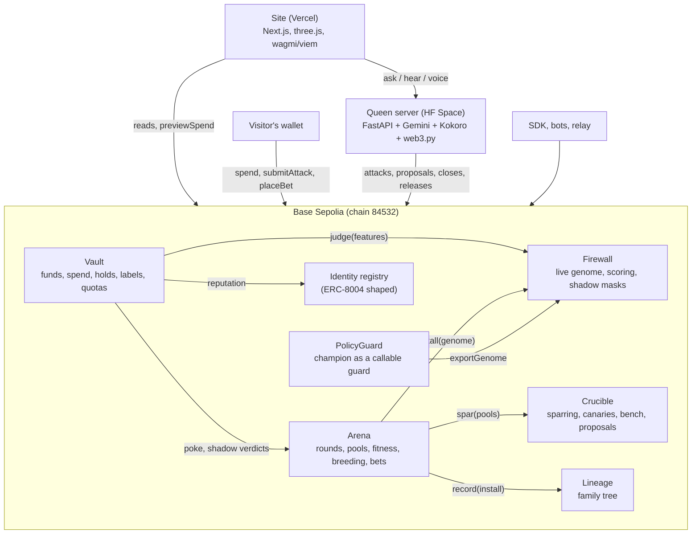
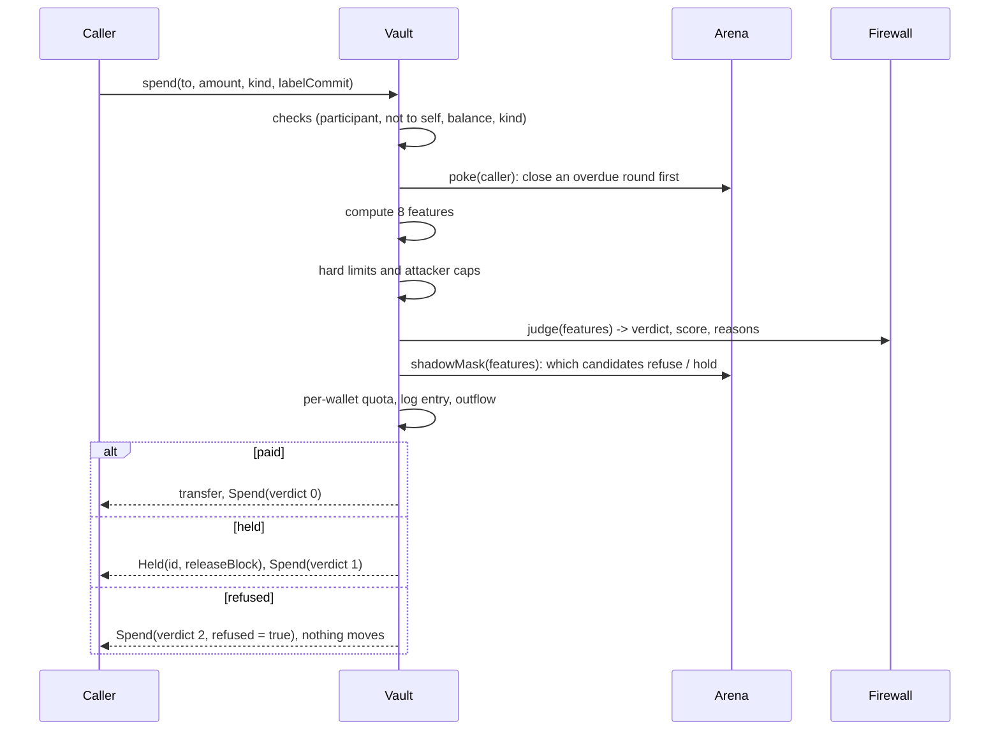
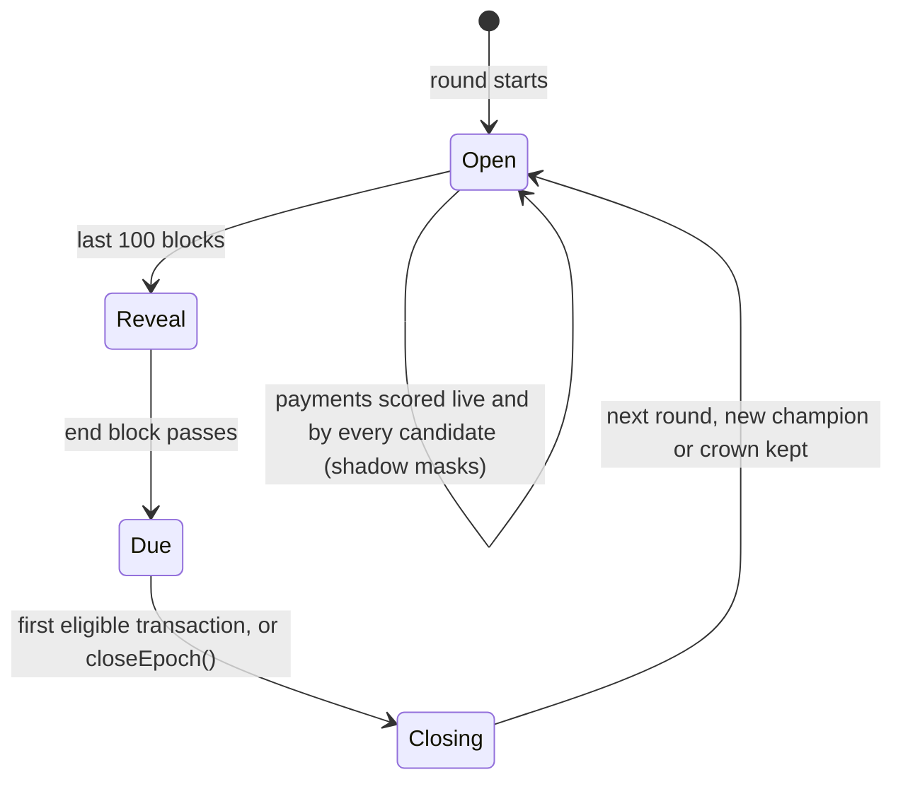
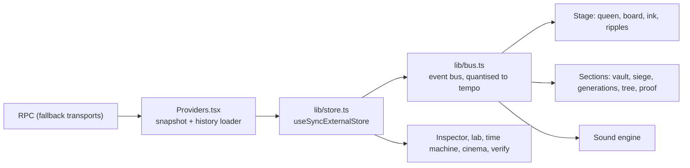

# Red Queen: architecture

This document describes how Red Queen works, from a single payment request to a new generation of policies, and every
component around the contracts. Constants are quoted from the source; file paths are relative to the repository root.

- [1. System overview](#1-system-overview)
- [2. The contracts](#2-the-contracts)
- [3. Judging one payment](#3-judging-one-payment)
- [4. The round: grading, selection and breeding](#4-the-round-grading-selection-and-breeding)
- [5. The Crucible](#5-the-crucible)
- [6. Attackers, stakes, rewards and bets](#6-attackers-stakes-rewards-and-bets)
- [7. The SDK](#7-the-sdk)
- [8. The site](#8-the-site)
- [9. The Red Queen's server](#9-the-red-queens-server)
- [10. Relay, bots and services](#10-relay-bots-and-services)
- [11. Asset pipelines](#11-asset-pipelines)
- [12. Security model](#12-security-model)
- [13. Deployment topology](#13-deployment-topology)
- [14. Testing](#14-testing)

---

## 1. System overview



Three principles shape the design:

1. **The chain decides.** Verdicts, grades, crowning and breeding all happen in Solidity. Off-chain components read,
   explain and send ordinary transactions; none has a privileged path.
2. **Evolution works inside fixed limits.** Hard limits, attacker caps and the monotone rule bound what any policy can
   let out. Evolution can only be stricter than the floor.
3. **Everything is reproducible.** Scoring is integer arithmetic. The SDK mirrors it bit for bit, so the site and any
   third party can recompute every verdict from the event log.

---

## 2. The contracts

All contracts are Solidity 0.8.28, compiled with the optimizer (200 runs) for the Cancun EVM; the Arena and Crucible
use the via-IR pipeline to fit the 24 KB code limit.

| Contract | File | Responsibility |
|---|---|---|
| Vault | `contracts/contracts/Vault.sol` | Holds the funds. `spend` measures, judges, logs and pays, holds or refuses. Deposits, holds (`release`, `veto`), honest-wallet registry, sealed labels, per-wallet quotas, attacker accounting |
| Firewall | `contracts/contracts/Firewall.sol` | Stores the live genome. `judge`, `score`, `explain`, `shadowMasks`, `monotoneGenome`, `exportGenome`. Only the Arena may `install` |
| Arena | `contracts/contracts/Arena.sol` | Rounds, the policy and attack pools, stakes, `closeEpoch` (grading, selection, slashing, compensation, crowning, breeding, attacker evolution), bets, claims |
| Crucible | `contracts/contracts/v2/Crucible.sol` | Plays every candidate against attack plans, a hall of fame, drain canaries and an honest bench; screens and enters proposed policies |
| Lineage | `contracts/contracts/Lineage.sol` | Append-only record of every installed policy, its parents, generation and fitness; ancestor queries |
| GenomeLib | `contracts/contracts/lib/GenomeLib.sol` | Genome packing, scoring, gates, verdict thresholds, crossover, mutation, monotone clamping |
| PolicyGuard | `contracts/contracts/helpers/PolicyGuard.sol` | Exposes the champion policy as a guard that any contract can call before moving funds |
| AgentProxy, GuardedAccount | `contracts/contracts/helpers/` | An agent wallet a principal funds through the vault (delegation), and an account guarded by the champion |
| SparReference | `contracts/contracts/helpers/SparReference.sol` | Reference implementation the tests use to check the Crucible's simulation |
| MockIdentityRegistry | `contracts/contracts/helpers/MockIdentityRegistry.sol` | ERC-8004-shaped identity registry for test networks |
| IRedQueen | `contracts/contracts/interfaces/IRedQueen.sol` | Shared interfaces |

Wiring is one-time: the deploy script links Vault, Arena, Crucible and Firewall, after which the Arena, Firewall and
Lineage owners have no remaining powers. The Vault's owner keeps only these powers: appointing registrars and guardians,
vetoing a held payment and setting the identity registry. There is no withdraw function and no way to install a
policy by hand.

---

## 3. Judging one payment

`Vault.spend(to, amount, kind, labelCommit)` is the single door out of the vault. `kind` is pay, withdraw (only to the
caller) or delegate (fund an agent that then acts for the caller). `labelCommit` is a sealed hash of the payment's
label ("honest" or "attack") with a secret, opened later.



### 3.1 The eight measurements

Each is an integer from 0 to 1,000 (`FEATURE_MAX`).

| # | Measurement | Computation |
|---|---|---|
| f0 | Size | amount × 1,000 ÷ the vault's payable balance |
| f1 | Recipient novelty | 1,000 for an address never paid, then 1,000 ÷ (1 + times paid) |
| f2 | Velocity | 200 (`VELOCITY_UNIT`) per earlier request by this caller in the last 20 blocks (`VELOCITY_WINDOW`) |
| f3 | Gap | blocks since this caller's last request, capped at 100 (`GAP_CAP`) and scaled to 1,000 |
| f4 | Reputation | 500 for a registered honest wallet, rising to 800 over 1,000 blocks (`REP_AGE_CAP`), plus 200 for an identity token; an agent inherits its honest principal's reputation |
| f5 | Through a contract | 1,000 when the transaction's signer is not the direct caller |
| f6 | Contract recipient | 1,000 when the recipient has code |
| f7 | Round outflow | (outflow so far this round + amount) × 1,000 ÷ the round's starting balance |

`previewSpend(caller, to, amount)` returns the same features and verdict for a hypothetical payment, free and without
state changes. The site calls it live while a visitor configures an attack.

### 3.2 The genome

A policy is 32 signed 16-bit integers packed into two words (`GenomeLib`):

| Genes | Name | Meaning |
|---|---|---|
| 0–7 | Weights w0–w7 | Linear weight per measurement. Positive penalises, negative forgives |
| 8–15 | Pattern weights v0–v7 | Bonus when a pair of measurements are both past their thresholds |
| 16–23 | Thresholds t0–t7 | When a measurement counts as high: t ≥ 0 fires at f ≥ t, t < 0 fires at f < abs(t) |
| 24–31 | Reserved | Carried through breeding, unused in scoring (attack genomes use all 32) |

The eight patterns pair measurements as follows: big payment to a stranger (size × novelty), big payment while
draining (size × outflow), new-recipient burst (novelty × velocity), salami slicing (velocity × outflow), contract
hop (through a contract × contract recipient), delegated drain (size × through a contract), rapid repeat (velocity ×
gap) and contract sink under outflow (contract recipient × outflow).

### 3.3 Score and verdict

```
score = Σ_i w_i · f_i  +  Σ_k v_k · 1000 · gate(f_a) · gate(f_b)
```

Verdicts are decided in this order:

1. A **hard limit** applies: refused.
2. score > 500,000 (`GLOBAL_THRESHOLD`): **refused**.
3. score > 350,000 (`HOLD_SCORE`): **held**.
4. Otherwise: **paid**.

The `Spend` event carries the verdict, the score, the packed features and a **reason bitmask**: every term that
contributed at least an eighth of the score, plus bits for the limits. A refusal never reverts; it is recorded and the
money stays.

**The monotone rule.** A larger payment, or a later one while money is leaving, must never score lower. Weights on
size and outflow must be non-negative, and every pattern gated on size or outflow must carry its gate's sign. The
Crucible refuses non-monotone proposals, and bred children are clamped to the rule (`Firewall.monotoneGenome`).

### 3.4 Limits under every policy

| Limit | Value | Reason bit |
|---|---|---|
| One payment | at most 50% of the payable balance (`MAX_SPEND_BPS`) | 16 |
| One round | outflow at most 50% of the round's starting balance (`MAX_ROUND_OUTFLOW_BPS`) | 17 |
| An attacker's payment | at most 10% of the payable balance (`ATTACK_SPEND_BPS`) | 18 |
| All attackers in a round | at most 20% of the starting balance together (`ATTACK_ROUND_BPS`) | 19 |
| An attacker's payment the rule would hold | refused instead of held | 20 |

An attacker is a wallet with an attack staked this round, whether it is the caller, the transaction's origin or the
principal of the agent making the call (`isAttacker`). Further protections keep the round's log fair:

- Each wallet may log at most 16 requests a round (`MAX_TX_PER_CALLER`); beyond that the call reverts with
  `CallerSaturated`.
- A wallet's second request over a hard limit in the same round reverts (`HardLimit`) instead of filling the log.
- The log holds 240 entries a round (`MAX_TX_PER_EPOCH`), 48 of them reserved for wallets that are not attacking
  (`HONEST_RESERVE`).
- The vault never pays itself (`PayToVault`). A deposit made in a round offsets that round's outflow, and only an
  attacker's own deposit offsets attacker outflow.

### 3.5 Holds

A held payment moves nothing. It is reserved (so `balance()` shows what the vault can still pay) and counts toward
the round's outflow. For 300 blocks (`HOLD_DELAY`, about a minute on Base Sepolia) the owner or a guardian may
`veto(id)`, and the money stays. After that anyone may `release(id)`. Wrong callers and early calls are refused with
`NotGuardian`, `TooEarly`, `AlreadySettled` or `UnknownHold`.

### 3.6 Who may ask

A caller must be a registered honest wallet, an agent funded by an honest or staked principal, or a wallet with an
attack staked this round; otherwise `NotParticipant`. Registrars (appointed by the owner) register honest wallets.

---

## 4. The round: grading, selection and breeding

A round (epoch) lasts at least 600 blocks on Base Sepolia (about two minutes), and the last 100 are the reveal window.



**During the round.** The live policy decides each payment. Every candidate in the shadow pool (up to 16,
`MAX_CANDIDATES`) also scores it, and the vault logs which would have refused and which would have held.

**Labels.** In the reveal window, wallets open their sealed labels (`revealLabels`). A payment counts as honest only
when it comes from a registered honest wallet that has not staked an attack this round; an unopened label counts as an
attack. Candidates therefore cannot know in advance which traffic is honest.

**Closing.** No timer closes a round. The first transaction after its end from a wallet not staked in it closes it,
inside that transaction, and earns the closer's tip; anyone may also call `closeEpoch()`. Every call that may carry a
close supplies a gas limit of at least 10 million (`CLOSE_GAS`); only the gas used is charged. A full close measures
about 9 million gas.

**The close, step by step** (`Arena.closeEpoch`):

1. **Seed.** The breeding seed is the hash of the round's last block (fixed before the round may close); if the close
   is more than 256 blocks late, a fixed later block is used. The source is emitted in a `Randomness` event.
2. **Sparring.** The Crucible plays every candidate (section 5) and emits one `Sparred` result each.
3. **Fitness.** For every candidate: `F = R − C + S`.
   - **R**: attack money it would have kept: a refused attack payment saves its amount, a held one half
     (`HOLD_CREDIT_BPS`).
   - **C**: the cost of honest payments it would have got wrong: a refusal costs twice the amount
     (`WRONG_REFUSAL_MULT`) plus 0.5% of the round's starting balance (`WRONG_REFUSAL_FLOOR_BPS`); a hold costs a tenth
     of that (`HONEST_HOLD_DIVISOR`).
   - **S**: the sparring score from the Crucible.
4. **Selection.** Candidates are ranked by fitness (stable on ties). The top four (`SURVIVORS`) survive and recover
   their stakes; the rest are slashed.
5. **Crown margin.** The best challenger is installed only if it beats the live champion by at least 1% of the
   round's starting balance (`MARGIN_BPS`); otherwise `CrownKept`.
6. **Slashing and compensation.** Slashed stakes are shared 60% to surviving authors, 30% to honest users the live
   policy wrongly refused, 10% to the protocol pool. Each wrongly refused honest user is also compensated from the pool
   (at most 32 per close, `MAX_COMPENSATED`).
7. **Installation.** The champion is written to the Firewall and recorded in the Lineage (`PolicyInstalled`).
8. **Breeding.** Survivors pair (1st with 2nd, 1st with 3rd, 2nd with 4th, 3rd with 4th). Each child takes each gene
   from either parent (uniform crossover), then two genes mutate by up to the deployment's mutation scale; children are
   clamped to the monotone rule and fill the freed slots. Children must win a later close to be crowned.
9. **Attackers evolve** the same way (section 6).
10. **Bets settle**, the closer is tipped and the next round begins.

---

## 5. The Crucible

The Crucible (`contracts/contracts/v2/Crucible.sol`) is an on-chain sparring partner and gatekeeper. It replays a
simulated vault (balance 1,000,000 units, the same eight measurements, the same velocity and gap windows) step by step
in Solidity.

Each candidate is played against:

- **Attack plans:** the first eight plans in the attack pool (`SIM_ATTACKS`), each up to eight steps.
- **The hall of fame:** the last four distinct plans that topped a round (`SIM_ARCHIVE`), kept even after they leave
  the pool, so a defence is not forgotten as soon as its attack disappears.
- **Drain canaries:** six fixed drain-sized payments (40% and 50% of the vault and the whole vault, through every
  route, `CANARIES`) plus an adaptive canary that probes each gate edge with the smallest score a stranger's 26% payment
  could have. Every policy must refuse them all.
- **An honest bench:** ten everyday honest payments (`honestBench`), priced like real wrong refusals with a floor so
  that refusing any of them costs as much as losing the vault.

The sparring score S is minus the average share of the vault the plans would take (a held step counts as half), minus
the bench cost, minus a vault's worth for each canary let through. A policy that refuses everything can never win.

**Proposals.** Anyone may call `Crucible.propose(genome)`. The policy is graded on the spot and entered into the pool,
or refused on the record with a code: honest payment refused (1), weaker than the champion (2), one per wallet per
round (3), pool full (4), lets a canary through (5), not monotone (6). The queen's server uses this path for the
policies she writes.

---

## 6. Attackers, stakes, rewards and bets

- **Attack plans are genomes** with all 32 genes active: amounts, recipients, delays and routes for up to eight steps.
  Anyone may `submitAttack(genome)` or `adoptAttack(id)` with a stake (0.0002 test ETH on the live deployment). The
  pool holds 16 plans (`MAX_ATTACK_POOL`) and up to 64 attackers a round (`MAX_ATTACKERS_PER_EPOCH`).
- **Stake return.** An attacker's stake comes back at the payment that takes that wallet's total for the round to at
  least the stake; otherwise it goes to the pool at the close.
- **Attacker evolution.** At each close the plans are graded by what they extracted against the live policy and in
  sparring; the best breed and replace the weakest, so defence and attack co-evolve.
- **Policy stakes.** Submitting a policy stakes 0.0005 test ETH, returned to survivors and slashed for the rest.
- **Bets.** `placeBet(lineageRoot)` backs a bloodline (pari-mutuel, minimum 0.0001); `settleBet` and `claim` pay the
  winners when that family holds the crown.
- **Closer's tip.** Whoever closes a due round earns a small tip from the protocol pool.

---

## 7. The SDK

`sdk/` (`@redqueen/sdk`, TypeScript on viem) is how agents and the site talk to the contracts.

| Module | Contents |
|---|---|
| `client.ts` | `RedQueen` client: snapshot of the arena, spend, preview, attack, propose, bet, claim, reveal, history |
| `genome.ts` | Bit-exact mirror of `GenomeLib`: packing, features, scoring, gates, verdicts, reasons, mutation; scripted attack presets |
| `events.ts` | Typed decoders for every event the site and bots consume |
| `executor.ts` | Multi-step attack execution with stake handling |
| `relay.ts` | Client for the WebSocket relay |
| `deployments.ts`, `abi.ts` | Addresses per chain and ABIs |
| `v2.ts` | Crucible-era helpers: honest bench, canaries, sparring mirrors |
| `examples/agent.ts` | A runnable agent that reads the live policy and probes it |

Because the scoring is mirrored exactly, the site predicts a verdict before the visitor signs, and the contract tests
check the SDK against the chain.

---

## 8. The site

`web/` is a Next.js 15 app with React 19. It reads the chain directly through viem with a fallback list of public RPC
endpoints; no server sits between the visitor and the contracts.

**Data flow.**



- **History** is loaded in atomic chunks from event logs, timestamped from the logs themselves; the snapshot and the
  history load in parallel.
- **One persistent WebGL canvas** sits behind the DOM. The hero is a glass chess queen whose silhouette is computed
  from the live genome (`lib/queen.ts`, `components/stage/Queen.tsx`); she morphs when a new champion is installed.
  Sections are camera stops on one path. Custom GLSL handles glass refraction, the board, ink trails and ripples
  (`components/stage/shaders.ts`, `fluid.ts`, `ink.ts`, `ripple.ts`).
- **The DOM carries every word** for accessibility; 3D anchors are projected to the screen so labels point at the
  parts of the queen they describe (`Anchors.tsx`, `ui/Annotations.tsx`).
- **Loading curtain** (`ui/Curtain.tsx`): her genome as a ring of 32 ticks that lights up as the fonts, stage,
  snapshot and history arrive, then the board turns over square by square from her square onto the live page.
- **Interaction:** wallet connection (wagmi), *Try to drain her* with live `previewSpend` predictions and a
  hold-to-confirm gesture, the attack lab, the policy inspector, bets, scar cards, the time machine, cinema and verify
  modes.
- **The film** (`overlays/Tour.tsx`, `lib/tour.ts`): ten narrated chapters with word-timed subtitles; chapter four
  sends one real 40% drain through her server and shows the contract's verdict.
- **Sound** (`lib/sound/`): a Web Audio engine with an ambience bed, foley, interaction sounds, strikes on verdicts and
  the narration, all scheduled on one tempo so simultaneous events form a chord.
- **Editions:** a 2D canvas edition without WebGL (`scene/Scene2D.tsx`), a phone edition, reduced motion, and
  keyboard shortcuts for every mode.

---

## 9. The Red Queen's server

`queen/` runs on a Hugging Face ZeroGPU Space: FastAPI routes mounted in a Gradio app, on the Space's CPU.

| Route | Purpose |
|---|---|
| `POST /api/ask` | A typed question: her words, actions, mood and a voice id |
| `POST /api/hear` | A spoken question (WAV): streams what she heard, then her reply |
| `GET /api/voice/{id}/{n}` | Sentence n of a reply as MP3; the first plays while the rest render |
| `GET /api/attack/{job}` | The status and verdict of an attack or proposal she is sending |
| `GET /api/line/{key}`, `/api/fillers` | Prepared lines and short fillers |
| `POST /attack` | The film's live attack |
| `POST /topup` | Test ETH for a judge's empty wallet, rate-limited |
| `GET /health`, `/alive` | Status (models, keys present, keeper, wallet) and a keep-alive |

**Answer pipeline.**

1. **Input screen** (`guard.screen_input`): length, secrets (keys and seed phrases are refused unread), code requests,
   prompt-injection patterns; pasted transaction hashes are checked on chain first.
2. **The turn** (`guard.build_turn`): her persona (`prompt.md`), the reference corpus (`knowledge.md`), a live
   snapshot of the arena and the visitor's recent conversation.
3. **The model** (`app._open`): Gemini with a structured JSON response (`say`, `actions`, `mood`). Quick questions go
   to the Flash-Lite family; deeper ones try the Flash family first with a reasoning budget. Two API keys, per-model
   rests on rate limits and overloads, and a hard deadline keep her answering; prepared answers cover a newcomer's
   first questions if no model can answer.
4. **Output screen** (`guard.screen_output`): leaked instructions, code, AI-identity talk and links are replaced with
   her set lines; actions are allow-listed; transaction hashes and addresses must appear in the visitor's own words;
   the film starts only when the visitor asks for it.
5. **Delivery** (`app._deliver`): her on-chain moves are rate-limited per visitor, per network and overall; attacks
   and proposals run in background jobs; the reply is voiced by Kokoro-82M (`voice.py`) sentence by sentence.

**Her tools.** Each answer may call up to three of 19 tools, checked against the allowlist in `guard.ACTIONS`:

| Kind | Tools |
|---|---|
| Show the page (the site carries them out) | `go` (a chapter), `inspect` (her genome or any policy), `explain_latest`, `card` (measures, score, round, family), `proof`, `time_machine`, `open_lab`, `cinema`, `sound`, `film`, `close` |
| Read the chain | `check_tx` (a hash the visitor gave, or the latest) |
| Act on chain herself (her server sends them) | `attack` (amount, repeats, fresh recipient), `propose` (a 24-gene policy for the Crucible) |
| Prepare for the visitor's own wallet | `pick_attack`, `allow_wallet`, `ask_payment`, `back_bloodline`, `connect_wallet` |

**On-chain hands** (`chain.py`, web3.py, her own test wallet):

- `attack(amount_pct, repeats, fresh_recipient)`: stakes for the round if needed and sends real payments to the
  vault; paid money is returned, held payments are released by her keeper when due and returned. If the vault turns a
  repeat away as a second over-the-limit request in the round, she shows the refusal already recorded that round.
- `propose(genes)`: submits a policy to the Crucible and reports its verdict.
- **The keeper** closes a due round that saw activity, closes quiet rounds on a schedule, and after a quiet close
  **spars**: a stake-sized payment, a 40% drain and smaller slices against the new champion, so every grade has real
  refusals in it.

**Live cards.** An answer may carry one `card` action (`measures`, `score`, `round` or `family`). The site draws
the card from its own chain data (`web/components/overlays/QueenCard.tsx`): the score card recomputes the terms with
the SDK's bit-exact `explain` and the genome that was live in that round, so the model names the card but never
supplies its numbers.

**Voice.** Kokoro-82M speaks her replies. After a visitor has spoken for about ten seconds, `clone.py` can render one
line in the visitor's own voice with a ZeroGPU-hosted model; the recordings stay in memory and are discarded.

**Limits.** Per device: 8 questions a minute and 150 a day; per network as well; a daily model budget; her on-chain
moves capped per visitor, per network (three visitors' worth) and per hour overall.

---

## 10. Relay, bots and services

| Component | Path | What it does |
|---|---|---|
| Relay | `relay/src/` | Subscribes to contract events and streams them over WebSocket; a public read API; a ten-minute replay buffer that fills in when the chain stalls |
| Bots | `bots/src/arena.ts`, `index.ts` | Six honest users, five scripted attackers, an evolved-attacker runner, challengers submitting policies, spectators and a closer, each with its own derived wallet |
| Demo service | `bots/src/demo.ts` | The film's live attack on a local chain |
| Top-up | `bots/src/topup.ts` | Registers a connecting wallet as honest and sends it test ETH, once per address |
| End-to-end | `bots/src/e2e.ts` | Deploys to a local chain and drives every path: attacks, holds, reveals, closes, compensation, bets; writes a report |
| Local arena | `bots/src/local.ts` | One command: local chain, deploy, relay, bots, top-up |
| Arena container | `spaces/arena/` | Hosts the relay, top-up, demo and bots behind one gateway |

---

## 11. Asset pipelines

| Pipeline | Path | Output |
|---|---|---|
| Narration | `tools/voice/render.py`, `lines.json` | `web/public/voice/*.mp3` and `manifest.json` with word and phrase timings (Chatterbox, zero-shot from `reference.flac`) |
| Her fillers | `tools/voice/render_fillers.py` | Short spoken fillers she uses while thinking |
| Display font | `tools/font/build_font.py` | `web/public/fonts/red-queen-glass-*.woff2`: Bodoni Moda recut with a channel of light down each thick stroke (COLRv0) |
| Sound library | `tools/sound/process.py` | `web/public/sound/*.mp3`, loudness-matched, with `manifest.json` and `CREDITS.txt` |

---

## 12. Security model

| Threat | Defence |
|---|---|
| A manipulated agent asks for a large payment | The live policy refuses or holds it; hard limits cap any single payment at half the vault |
| Many small slices (salami) | Round-outflow measurement, salami pattern, the round's hard limit and the attackers' 20% round cap |
| Routing through agent contracts | Attacker status follows the caller, the origin and the agent's principal; no discount for contract hops |
| A rule that lets drains through | Drain canaries and the adaptive canary; a policy that lets one through is refused or loses a vault's worth of fitness |
| A rule that refuses everyone | Honest-bench cost and priced wrong refusals; compensation for honest users |
| Evolution forgetting an old attack | Hall of fame of recent round-topping plans in every sparring match |
| Flooding the round's log | 16 requests per wallet per round, revert on a second hard-limit breach, 48 honest slots reserved |
| Gaming the next round's seed | Seed fixed at the round's last block, before anyone may close |
| Tuning a policy to known labels | Commit-reveal labels, opened only after the round's traffic |
| Admin override | No withdraw, no manual install; the owner can only appoint registrars and guardians and veto holds |
| Prompt injection against her | Input and output screens, allow-listed actions, rate limits; she holds only test ETH and has no privileged role |

---

## 13. Deployment topology

| Piece | Where | Notes |
|---|---|---|
| Contracts | Base Sepolia | Addresses in `deployments/84532.json`; source verified on Basescan |
| Site | Vercel, root directory `web/` | One variable: `NEXT_PUBLIC_CHAIN_ID=84532` |
| Her server | Hugging Face Space (ZeroGPU), contents of `queen/` | Secrets in the Space settings |
| Relay, bots, top-up | Optional: any Node host, or `spaces/arena/` | Not required for the hosted arena |

Step-by-step instructions: [DEPLOYMENT.md](DEPLOYMENT.md).

---

## 14. Testing

| Suite | Command | Covers |
|---|---|---|
| Contracts | `npm test` | Genome and firewall maths, SDK parity, vault limits, holds, quotas, arena rounds, crowning, breeding, Crucible sparring, canaries and proposals, gas of a full close |
| End to end | `npm run e2e` | The whole backend on a local chain with bots and the relay |
| Her guard | `cd queen && python3 -m pytest -q test_guard.py` | Input and output screening, actions, limits, memory, verdict wording, prepared answers |
| Type checks | `npx tsc --noEmit` in `sdk/`, `web/`, `bots/`, `relay/` | The TypeScript packages |
